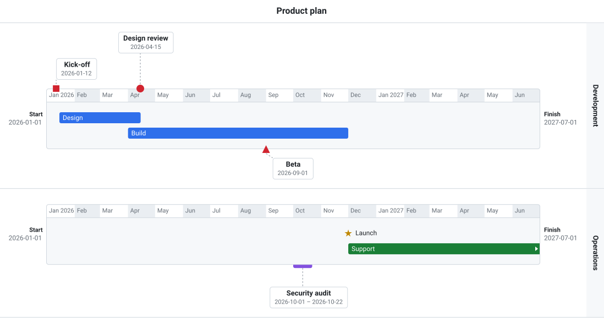
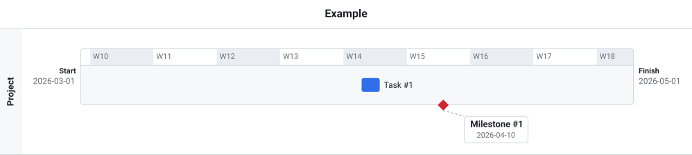
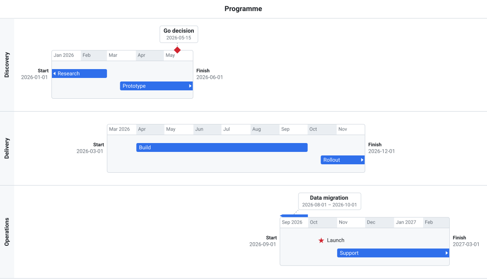

# Timeline-view

A timeline view for use in web planning applications. Framework-free TypeScript with no runtime dependencies.



- Several timelines stacked in one view, each with its own date range, on an hour, day, week, month or year scale.
- Relative timelines that each fill the width, or absolute ones on a common time axis.
- Arrows on tasks that continue past a timeline's range.
- Date markers (such as "Today") across one, several or all timelines.
- Tasks drawn as bars and milestones as symbols, on the bar or as callouts above and below it.
- Drag and drop between lines, areas and timelines.
- Export as SVG (`timeline.toSVG()`).
- Optional REST backend for saving moves, with optimistic updates and rollback.

```sh
npm install
npm run dev       # examples at /examples/index.html
npm run build     # dist/timelineview.js, .mjs, .css, and the example images in docs/images
npm version x.y.z # update npm version number, add version tag to github, update version numbers in README.md.
npm publish       # to publish ar_timeline_view to npmjs.com
```

A minimal timeline, from [examples/basic.html](../examples/basic.html):



Timelines with different date ranges on a common time axis (`absolute: true`), from the second view in [examples/features.html](../examples/features.html):



The image at the top is the first view in [examples/features.html](../examples/features.html). All images are exported with `toSVG()` by `npm run build`.

Docs: 
- [getting started](../docs/getting-started.md)
- [user guide](../docs/user-guide.md)
- [developer guide](../docs/developer-guide.md)
- [REST API](../docs/api/openapi.yaml).
