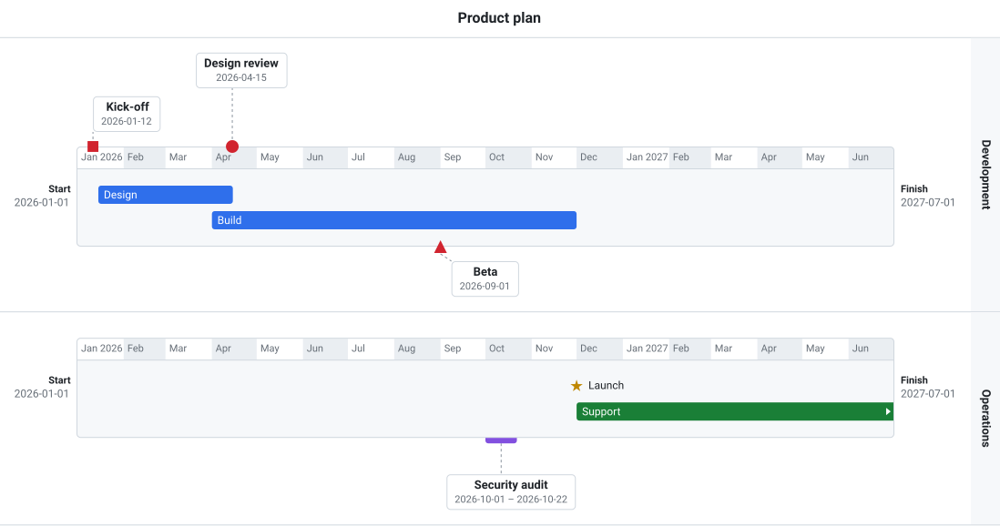
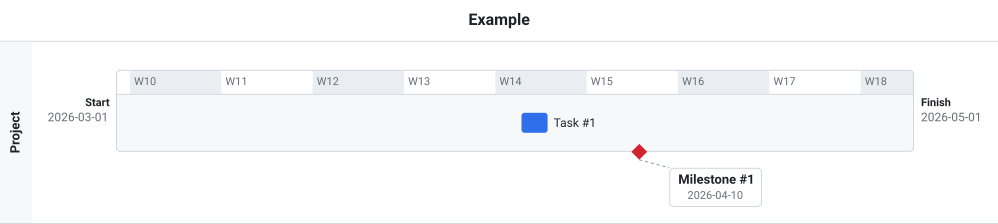

# Timeline-view

A timeline view for use in web planning applications. Framework-free TypeScript with no runtime dependencies.



- Several timelines stacked in one view, on an hour, day, week, month or year scale.
- Tasks drawn as bars and milestones as symbols, on the bar or as callouts above and below it.
- Drag and drop between lines, areas and timelines.
- Export as SVG (`timeline.toSVG()`).
- Optional REST backend for saving moves, with optimistic updates and rollback.

```sh
npm install
npm run dev     # examples at /examples/index.html
npm run build   # dist/timelineview.js, .mjs, .css, and the example images in docs/images
```

A minimal timeline, from [examples/basic.html](examples/basic.html):



The image at the top is [examples/features.html](examples/features.html). Both images are exported with `timeline.toSVG()` by `npm run build`.

Docs: [getting started](docs/getting-started.md), [user guide](docs/user-guide.md), [developer guide](docs/developer-guide.md), [REST API](docs/api/openapi.yaml).
