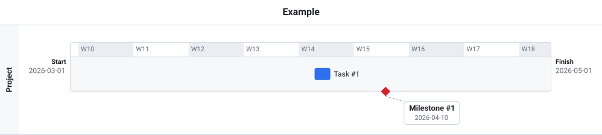

# Getting started

## Add it to a page

This page builds the timeline below (the same as [examples/basic.html](../examples/basic.html)):



Build the library (`npm install`, then `npm run build`) and copy `dist/timelineview.js` and `dist/timelineview.css` into your site. Then:

```html
<!DOCTYPE html>
<html>
<head>
    <script src="timelineview.js"></script>
    <link href="timelineview.css" rel="stylesheet">
</head>
<body>
    <div id="timeline_here" style="width: 1000px; height: 400px;"></div>
    <script>
        timeline.init("timeline_here");
        timeline.parse({
            view: { name: "Example", scale: "week" },
            tasks: [
                { id: 1, text: "Task #1", start_date: "2026-04-01", duration: "2d" },
                { id: 2, text: "Milestone #1", start_date: "2026-04-10" }
            ],
            timelines: [
                { id: 1, name: "Project", start_date: "2026-03-01", finish_date: "2026-05-01", entries: [
                    { task: 1, placement: "on", line: 1 },
                    { task: 2, placement: "below", callout_offset: { x: 30, y: 16 } }
                ]}
            ]
        });
    </script>
</body>
</html>
```

The `height: 400px` on the container is optional. Without a height, the container fits the timelines exactly and grows as they grow. With one, the view scrolls inside it when the timelines are taller. See [Sizing the container](user-guide.md#sizing-the-container).

## Use it as a module

```js
import { TimelineView } from "timeline-view";
import "timeline-view/timelineview.css";

const view = new TimelineView(document.getElementById("timeline_here"));
view.parse(data);
```

## Save changes

Without a backend, listen for moves and save them yourself:

```js
timeline.on("entry_moved", ({ timeline_id, task_id, patch }) => {
    // patch holds only the changed fields: timeline_id, placement, line, callout_offset
    save(timeline_id, task_id, patch);
});
```

Or point the view at a backend that implements the [REST API](api/openapi.yaml):

```js
timeline.init("timeline_here", { api_url: "https://example.com/api" });
timeline.load("my-view-id");
```

Next: the [user guide](user-guide.md) covers the data format and interactions in detail.
