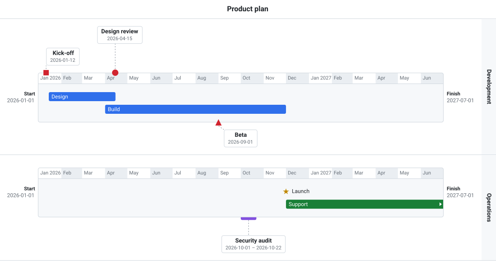
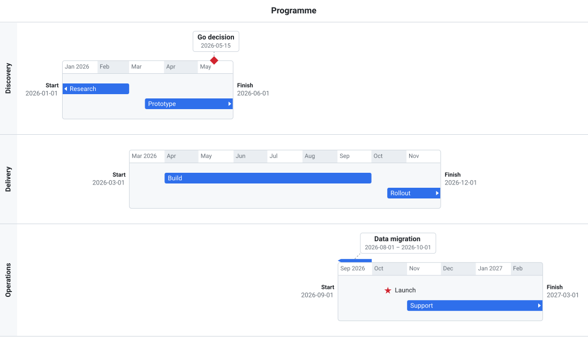

# User guide

## Concepts

If the view has a `name`, it is shown as a centered heading above the timelines. Leave it empty (`""`) if your page already has its own heading.



*[examples/features.html](../examples/features.html): two timelines on a month scale, with callouts above and below the bars.*

A **view** holds one or more **timelines**, stacked vertically. Each timeline has its own time range (`start_date` to `finish_date`) and three **areas**:

- **above:** callout labels above the bar.
- **on:** the bar itself, with the time scale and task **lines**, numbered from 0.
- **below:** callout labels below the bar.

The callout areas have no lines: each label is placed freely by its offset, and the area grows to fit all of its labels.

A **task** is placed on a timeline by an **entry**. The entry's fields decide the area:

- `{ task: 1, line: 1 }`: on the bar, on line 1. Leave out `line` for line 0.
- `{ task: 2, callout_offset: { x: 30, y: 16 } }`: a callout; `y > 0` puts it below the bar.
- `{ task: 3, callout_offset: { x: 0, y: -16 } }`: a callout; `y` zero or negative puts it above the bar.

An entry can't have both `line` and `callout_offset`. One task can appear on several timelines, but only once on each.

## Data format

```js
{
  version: 7,                         // optional, set by the REST backend
  view: {
    id: "v1",                         // needed with a REST backend
    name: "Example",                  // heading above the timelines; "" for none
    absolute: false,                  // true: all timelines on one common time axis (default false)
    scale: "week",                    // hour | day | week | month | year (default day)
    name_position: "left",            // left | right (default left)
    milestone_symbol: "diamond",      // diamond | circle | square | triangle | star
    show_dates: true,                 // show Start and Finish dates beside each bar (default true)
    compact_lines: false,             // close up bar lines a move leaves empty (default false)
    selection: true                   // clicks select and highlight tasks and timelines (default true)
  },
  tasks: [
    { id: 1, text: "Task #1", start_date: "2026-04-01", duration: "2d", color: "#0a7f5a" },  // own color
    { id: 2, text: "Milestone #1", start_date: "2026-04-10", symbol: "star" }
  ],
  timelines: [
    { id: 1, name: "Project",
      start_date: "2026-03-01",       // ISO 8601: YYYY-MM-DD, YYYY-MM-DDTHH:mm or a full timestamp (see Dates)
      finish_date: "2026-05-01",
      entries: [
      { task: 1, line: 1 },                                 // bar line 1
      { task: 2, callout_offset: { x: 30, y: 16 } },     // label below the bar
      { marker: "today" }                                // show marker "today" on this timeline
    ]}
  ],
  markers: [                                             // optional, see Markers below
    { id: "today", text: "Today", date: "2026-03-20" }
  ]
}
```

### Tasks and milestones

A task's finish is either its `start_date` plus its `duration`, or a `finish_date` you give instead. Use one or the other, not both. A task with neither, a zero `duration`, or a `finish_date` equal to its `start_date` is a **milestone** and is drawn as a symbol: `diamond` (the default), `circle`, `square`, `triangle` or `star`, set for all milestones by `view.milestone_symbol` or for one by its `symbol`. Any other value is an error: `parse()` throws. Otherwise the task is drawn as a bar from its start date to its finish date.

```js
{ id: 1, text: "Build", start_date: "2026-04-01", duration: "2w" },
{ id: 2, text: "Review", start_date: "2026-04-15", finish_date: "2026-04-17" },
{ id: 3, text: "Release", start_date: "2026-04-20" }   // milestone
```

`duration` is a whole number plus a unit:

| Unit | Meaning | Example |
|------|---------|---------|
| `h`  | hours   | `"5h"`  |
| `d`  | days    | `"2d"`  |
| `w`  | weeks   | `"3w"`  |
| `m`  | months  | `"3m"`  |
| `y`  | years   | `"1y"`  |

Months and years follow the calendar: one month from 31 January ends on 28 February.

### Dates

Every date (a task's `start_date` and `finish_date`, a timeline's range, a marker's `date`) is ISO 8601, in one of these forms:

| Form | Example |
|------|---------|
| A date | `"2026-04-01"` |
| A date and time | `"2026-04-01T09:30"` |
| With seconds, and a fraction | `"2026-04-01T09:30:15"`, `"2026-04-01T09:30:15.250"` |
| With a zone: `Z` (UTC) or an offset | `"2026-04-01T09:30:00Z"`, `"2026-04-01T09:30:00+02:00"` |

The view works in UTC. A time with a zone is converted to UTC; a date, or a time without a zone, is read as UTC. So `"2026-04-01T09:30:00+02:00"` is drawn at 07:30, and labels show it as `2026-04-01T07:30`. `serialize()` returns each date exactly as you gave it, so timestamps from your backend (for example from `toISOString()`) go back unchanged.

### Showing dates your way

By default the view writes dates as `2026-04-01` (and times in UTC, `2026-04-01T07:30`), and the time scale in English ("Jan 2026", "Feb"). To match the rest of your app, pass your own formatters when you create the view:

```js
timeline.init("timeline_here", {
  // Every date shown: callout labels, tooltips, Start/Finish, marker labels.
  format_date: (date, info) => formatForDisplay(date, info),
  // The time scale's labels.
  format_tick: (date, info) =>
    new Intl.DateTimeFormat(navigator.language, {
      timeZone: "UTC",
      month: "short",
      ...(info.major && { year: "numeric" }),
    }).format(date),
});
```

`format_date(date, info)` gets a `Date` and `info`:

| Field | Meaning |
|-------|---------|
| `kind` | Which date: `task_start`, `task_finish`, `milestone`, `timeline_start`, `timeline_finish` or `marker`. |
| `date_only` | `true` for a value without a time of day, such as `"2026-04-01"`. |

**Plain dates are calendar days, not moments.** `"2026-04-01"` is stored as midnight UTC, so formatting it in the user's time zone shows 31 March anywhere west of UTC. Format `date_only` values with `timeZone: "UTC"`, and only values with a time in the user's zone:

```js
const formatForDisplay = (date, info) =>
  new Intl.DateTimeFormat(navigator.language, info.date_only
    ? { dateStyle: "medium", timeZone: "UTC" }                 // the calendar day as written
    : { dateStyle: "medium", timeStyle: "short" }              // a moment, in the user's zone
  ).format(date);
```

`format_tick(date, info)` gets the start of the period the label marks, in UTC (the scale's periods are UTC days, weeks, months and years), with `info.scale` and `info.major` (the first label, and each new year on a month scale or new day on an hour scale; the default labels add the year or date to those, and they are kept longest when labels don't fit). Format it with `timeZone: "UTC"` too, or a label can name the period before.

Leave either out for the built-in format; `defaultFormatDate` and `defaultFormatTick` are exported if you want to fall back to them for some cases. A formatter that throws, or returns something other than a string, is logged and the built-in format is used for that label. `timeline.setFormatters({ format_date, format_tick })` changes them later and redraws (pass `undefined` for one to go back to the built-in format). The positions on the bar don't change, only the text; `toSVG()` exports the text as shown.

### The bar

The time scale on top of the bar shades its periods (days, weeks, months, ...) alternately light and darker. Beside the bar, the timeline's start date is shown under "Start" and its finish date under "Finish". Set `show_dates: false` to hide them and give the bar the full width.

A task that starts before its timeline's start date, or finishes after its finish date, is cut off at the bar's edge and gets a small arrow pointing out on that side. A task entirely outside the range is a short stub with an arrow at the nearest edge. As a callout, such a task's marker on the bar's edge gets a pointed end instead.

### Absolute and relative timelines

Each timeline has its own `start_date` and `finish_date`. The view's `absolute` option decides how the bars line up:

- `absolute: false` (default): every bar fills the full width, scaled to its own range. Good for comparing the shape of each timeline.
- `absolute: true`: all timelines share one time axis, from the earliest start to the latest finish. Each bar sits at its place on that axis, so the same date is at the same position on every timeline.



*The second view in [examples/features.html](../examples/features.html), with `absolute: true`.*

### Callouts

An entry placed `above` or `below` is shown as a label with the task's name, start date and finish date, centered. On the bar's edge nearest the label, a marker shows where it belongs:

- a milestone gets its symbol (a diamond by default), centered on the edge at its date;
- a task gets a short bar over its dates, with rounded outer corners.

A dashed connector runs from the middle of the marker to the label. `callout_offset` places the label, in pixels from the attachment point, which is the bar's edge at the middle of the task's dates (a milestone's date):

- `x`: to the label's left edge.
- `y`: to the label's edge nearest the bar. It also picks the side: positive is below the bar, zero or negative above it.

An entry without `callout_offset` is on the bar, not a callout. The area grows or shrinks so every label fits inside it.

## Sizing the container

The view fills the element you pass to `init()` (or `new TimelineView()`). Its contents always take the height they need: the timelines stacked, each as tall as its bar lines plus callout areas that fit their labels. How the element's own size relates to that:

| Container | What you get |
|-----------|--------------|
| No height (`height: auto`, the default for a `div`) | The container is exactly as tall as the timelines. It grows and shrinks as entries move (a new bar line, a label dragged further out), and the page below moves with it. Nothing scrolls inside the view. |
| A fixed `height`, taller than the content | The timelines sit at the top, with the view's background as empty space below. |
| A fixed `height`, shorter than the content | The view scrolls vertically inside the container. The timelines are not squeezed; they keep their full height. |
| `max-height` | Grows with the content, like no height, up to the limit, then scrolls. Often the best choice in a page layout. |
| `height: 100%` | Only works if the parent has a definite height (for example a flex or grid cell, or a parent with its own `height`). Otherwise it behaves like no height. |

Width works the same way: without a width the container fills its parent, and the bars stretch to the available width. Each timeline is at least 480 px wide; in a narrower container the view scrolls sideways.

The container's size never changes the time scale's dates or the callout offsets, only what is visible. `toSVG()` exports the timelines' full extent, whatever the container's size and scroll position, without empty space below.

```html
<!-- Fits its content: -->
<div id="timeline_here"></div>
<!-- Fixed size, scrolls when the content is taller: -->
<div id="timeline_here" style="height: 400px;"></div>
<!-- Grows up to 600px, then scrolls: -->
<div id="timeline_here" style="max-height: 600px;"></div>
```

### Resizing, and docking panels

The view follows its container's size by itself. When the container changes size (the window is resized, a split pane or docking panel is dragged, a sidebar opens), the bars stretch or shrink with it and everything that depends on the width is laid out again: marker lines, label connectors, and which time-scale labels are shown. When the bars get too narrow for every label, some are left out (every second one, and so on); labels with the year (month scale) or the date (hour scale) are kept first, so you can still tell where you are.

A view that is hidden (`display: none`), as in an inactive tab, is laid out when it is shown again. You can create and fill a view while it is hidden.

In a docking layout such as [dockview](https://dockview.dev), give the view's element `height: 100%` so it fills the panel and scrolls inside it:

```js
// A dockview panel that shows a timeline view.
class TimelinePanel {
  constructor() {
    this.element = document.createElement("div");
    this.element.style.height = "100%";
  }
  init(params) {
    this.view = new timeline.TimelineView(this.element);
    this.view.parse(params.params.data);
  }
  dispose() {
    this.view.destroy();
  }
}
```

Nothing else is needed: the view notices the panel's size changes and tab switches itself. If you want to trigger the layout yourself, for example from your docking library's resize callback, call `view.resize()`. It is cheap (it doesn't rebuild the view) and does nothing while the view is hidden.

### Markers

A **marker** marks a date with a vertical line across the bars, such as "Today" or a deadline. Markers are listed in `markers`:

```js
markers: [
  { id: "today", text: "Today", date: "2026-06-20", global: true },
  { id: "review", text: "Budget review", date: "2026-11-15", color: "#8250df", marker_offset: { x: 10, y: 20 } }
]
```

| Field | Meaning |
|-------|---------|
| `id`, `text`, `date` | Identity, label text, and the date the line is drawn at. |
| `global` | `true`: shown on every timeline. `false` (default): only on timelines with a `{ marker: id }` entry. |
| `color` | Any CSS color. Default: red (`--tlv-marker`). |
| `marker_offset` | Places the label, like `callout_offset`: `y ≤ 0` above the topmost bar, `y > 0` below the bottommost. Default `{ x: 0, y: -16 }`. |

To show a non-global marker, add `{ marker: id }` to the `entries` of each timeline that should show it. The line starts at the top of the topmost of those timelines' bars and ends at the bottom of the bottommost, crossing any timelines in between. A global marker runs from the top of the first bar to the bottom of the last. The label, with the marker's text and date, is joined to the line's top or bottom end.

Drag a marker's label to move it, as you drag a callout label. Dropped above a bar, it goes above the topmost timeline showing the marker; dropped below a bar, below the bottommost: a marker's label always sits at one end of its line. The area it will land in is highlighted while you drag. The new position is the marker's `marker_offset` in `serialize()`, and fires `marker_moved`:

```js
timeline.on("marker_moved", (e) => { /* e.marker_id, e.marker_offset */ });
timeline.setMarkerOffset("today", { x: 10, y: 20 });   // the same from code
```

With a REST backend a moved label is saved too.

You can also add, change and remove markers from code:

```js
timeline.addMarker({ id: "golive", text: "Go-live", date: "2026-05-04" });   // shows on no timeline yet
timeline.showMarker("dev", "golive");                                        // ...now on "dev"
timeline.hideMarker("dev", "golive");
timeline.updateMarker("golive", { text: "Launch", color: "purple" });        // only what changes
timeline.updateMarker("golive", { color: null, global: true });             // theme color, on every timeline
timeline.removeMarker("golive");                                             // also from every timeline
```

`addMarker` takes a marker in the same format as `markers`. A `global` marker shows on every timeline; any other only on the timelines you show it on (`showMarker`, which adds the timeline's `{ marker }` entry). The changes are checked as `parse()` would check them; an invalid one is refused and nothing changes. Like the other changes they return promises, and fire events:

| Event | Gets |
|-------|------|
| `marker_added` | `{ marker_id, marker }` |
| `marker_updated` | `{ marker_id, marker, old_marker }`: after and before (a moved label fires this and `marker_moved`) |
| `marker_removed` | `{ marker_id, marker, timelines }`: the timelines that showed it by entry, after the removal |
| `marker_shown`, `marker_hidden` | `{ timeline_id, marker_id, timeline }` |

With a REST backend all of them are saved. [examples/rest.html](../examples/rest.html) has a small marker editor.

With `absolute: true` the line runs straight down the common time axis. Without it, each timeline has its own axis, so the line is drawn only on the timelines whose range holds the date, and a global marker is drawn on each timeline separately: a line across that timeline's bar and its own label, just as if you had added the marker to that timeline alone. The labels share the marker's `marker_offset`, so dragging one moves them all.

## Moving entries

Drag a task bar, milestone or label with the mouse, pen or a finger:

- Drop a bar or milestone on any bar line of any timeline. The line under the pointer is highlighted. Drop it on the thin strip just above the first line or below the last one to insert a new line there.
- Drop anything above or below a bar to make it a label there; the label stays where you drop it.
- Drop a label beyond the edge of its area, or even outside the view, and it goes to the nearest label area, which grows to include it.
- Press Escape to cancel.

The number of bar lines comes from the entries: one more than the highest `line` used, and at least one. After every move, blank lines at the top and bottom of the bar are removed, and the lines close up so the first one is line 0. A blank line between used lines stays as a gap, unless the view has `compact_lines: true`: then a line that a move leaves empty closes up, and the lines below it move up, so the bar never has gaps. That also applies when a task is taken off a timeline or removed. Inserting a line moves the lines below it down by one. With a REST backend, the server must follow the same setting (the view's `compact_lines` is in the data it stores).

Dragging doesn't change a task's dates.

A press becomes a drag once the pointer has moved a few pixels; released before that, it's a click. `timeline.isDragging()` tells whether a drag is in progress, for example to hold back your own updates or keyboard shortcuts until it's over. Two events mark a drag's start and end:

```js
timeline.on("dragging_started", (e) => {
  // e.kind: "entry" (with e.timeline_id, e.task_id) or "marker" (with e.marker_id)
});
timeline.on("dragging_ended", (e) => {
  // the same, plus e.dropped: false when cancelled (Escape) or released where nothing can go
});
```

`dragging_ended` fires after the drop has been applied, so after its `entry_moved` (or `marker_moved`), and `isDragging()` is already false in both. A drag cancelled by Escape, a cancelled pointer, or the view being destroyed still ends with `dragging_ended`. Drags you run yourself from outside the view (with `targetAt`) don't count.

## Adding entries from outside the view

To let users drag items from your own page (a backlog list, a search result) onto the view, handle the drag yourself and ask the view where the pointer is. [examples/add.html](../examples/add.html) is a complete page.

- `timeline.targetAt(x, y, task)` returns the drop target at a point, in client coordinates (`e.clientX`, `e.clientY` of a pointer or drag event), or `null` outside the view. A target is `{ timeline_id, placement, line, new_line }` for a bar line (`new_line: true` on the strip above the first line or below the last), or `{ timeline_id, placement, callout_offset }` for the area above or below a bar. Inside the view but not on a bar line or label area (on a name or the time scale), it is the nearest label area, as for drags inside the view. Pass `task` (its id, or the data of a new task) to get a `callout_offset` that puts the label's corner at the point; without it the label gets the default position. Your drag ghost may cover the view: `targetAt` looks through elements that aren't part of the view.
- `timeline.highlightTarget(target)` highlights that target the way the view's own drags do; `highlightTarget(null)` removes the highlight.
- `timeline.addEntry(task, target)` adds the task there. `task` is the id of a task the view already has, or a new task's data (as in `tasks`), which is added to the view's tasks. It fires `entry_added`, and returns a promise like the other changes (see [Saving to a REST backend](#saving-to-a-rest-backend)). The promise rejects without changing anything if the timeline or task is unknown, the task is already on that timeline (a task can be on several timelines, once on each), new task data reuses an existing id, or the target is invalid.

```js
// In your pointermove handler:
const target = timeline.targetAt(e.clientX, e.clientY, task);
timeline.highlightTarget(target);

// In your pointerup handler:
timeline.highlightTarget(null);
if (target) timeline.addEntry(task, target).catch((error) => showMessage(error.message));
```

You can also build a target yourself: `addEntry(5, { timeline_id: 2 })` puts task 5 on line 0 of timeline 2's bar, and `{ timeline_id: 2, callout_offset: { x: 0, y: 20 } }` makes it a label below the bar. The same placement rules as for moves apply, and the bar is trimmed afterwards in the same way.

`entry_added` gets `{ timeline_id, task_id, task, new_task, entry, timeline }`: the task's data, whether it was new, the new entry, and the whole timeline after the add (inserting a line renumbers the lines below it). With a REST backend the addition is saved too, a new task in the same request as its entry.

### Taking a task off a timeline

`timeline.removeEntry(timeline_id, task_id)` takes a task off one timeline. The task stays in the data, on its other timelines or on none, so you can add it again later; use `removeTask` to delete it everywhere. The timeline's bar lines close up as after a move. It fires `entry_removed` with `{ timeline_id, task_id, entry, timeline }`, and returns a promise that rejects if the task isn't on that timeline. A task can be on several timelines, so it needs both ids; `onTaskClick` gives you both:

```js
let clicked;
timeline.attachEvent("onTaskClick", (taskId, e, timelineId) => (clicked = { taskId, timelineId }));
document.getElementById("remove").addEventListener("click", () => {
  if (clicked) timeline.removeEntry(clicked.timelineId, clicked.taskId).catch(() => {});
});
```

[examples/add.html](../examples/add.html) does this with a "Remove from timeline" button.

## Using it from React

`ar-timeline-view/react` has an optional `Timeline` component (React 18 or later; only this import needs React):

```jsx
import { useRef, useState } from "react";
import { Timeline } from "ar-timeline-view/react";
import "ar-timeline-view/timelineview.css";

function Plan({ initialData }) {
  const [data] = useState(initialData);
  const view = useRef(null);   // the TimelineView, for moveEntry, updateTask, toSVG, ...
  return (
    <Timeline
      ref={view}
      data={data}
      style={{ height: "100%" }}
      onEntryMoved={(e) => save(e)}
      onTaskClick={(taskId, event, timelineId) => console.log(taskId, timelineId)}
    />
  );
}
```

| Prop | Meaning |
|------|---------|
| `data` | The data to show, as for `parse()`. It is loaded when the component mounts and again whenever you pass a different object; re-rendering with the same object doesn't reload it. |
| `templates` | [Class templates](#styling-with-class-templates). Keep the object stable; a new one redraws the view. |
| `controls` | Show the [built-in controls](#built-in-controls). Changing it redraws the view. |
| `formatDate`, `formatTick` | As the `format_date` and `format_tick` options (see [Showing dates your way](#showing-dates-your-way)). Changing them redraws the view. |
| `apiUrl`, `fetch` | As the `api_url` and `fetch` options: with `apiUrl`, changes are saved to the REST backend. Changing either creates a new view. |
| `viewId` | With `apiUrl`: the view to load from the backend (`load()`), again when it changes. |
| `on...` | Every event as a prop: `onEntryMoved` for `entry_moved`, `onSaveFailed` for `save_failed`, and so on, plus `onTaskClick`, `onTimelineClick`, `onTaskSelected` and `onTimelineSelected`. The current handler is always called; passing a new function doesn't re-subscribe anything. |
| `onError` | Called when `data` is invalid or `viewId` can't be loaded. Without it, invalid data throws (to your error boundary). |
| `className`, `style` | For the view's container, which sizes as in [Sizing the container](#sizing-the-container). |
| `ref` | The `TimelineView`, for everything else: `moveEntry`, `updateTask`, `selectTask`, `toSVG`, `whenSaved`, ... It is `null` until mounted. |

The component creates the view when it mounts and destroys it when it unmounts, and works under `StrictMode`. Changes made in the view (dragging, or calls through the `ref`) stay in the view; you don't need to feed them back through `data`. Pass new `data` only to show something else. Inside a dockview panel, give it `style={{ height: "100%" }}` (see [Resizing, and docking panels](#resizing-and-docking-panels)).

## Finding a task's position

`timeline.getTaskPosition(task, timeline, from, to)` tells where a task, or any date span, sits on a timeline's bar, so you can place your own elements there:

```js
const pos = timeline.getTaskPosition("build", "dev");
// { left: 310, right: 280, top: 14, height: 28, width: 20 }
const part = timeline.getTaskPosition("build", "dev", new Date("2026-04-01T00:00:00Z"), new Date("2026-04-03T00:00:00Z"));
```

| Field | Meaning (CSS pixels, relative to the bar's task area, `.tlv-track`) |
|-------|---------|
| `left` | From the area's left edge to the start of the span. |
| `right` | From the end of the span to the area's right edge. |
| `top` | From the area's top edge to the task's line (the first line for a callout). |
| `height` | The height of a bar line. |
| `width` | From the first date to the second; 0 for a milestone. |

`task` is a task or its id, and `timeline` a timeline or its id (a task can be on several). `from` and `to` are a `Date` or a date string as in the data, and default to the task's own start and finish, and dates outside the timeline's range are held at the bar's edges. The values describe the layout right now, so ask again after the view is resized. It returns `null` for an unknown task, a task that isn't on that timeline, or a view that isn't shown.

## Styling with class templates

`timeline.templates` holds functions that return extra CSS classes for the view's elements, so styling can depend on the data, including your own attributes on tasks and timelines:

```js
timeline.templates.task_class = (start, end, task) => (task.priority === "high" ? "urgent" : "");
timeline.templates.scale_cell_class = (start) => ([0, 6].includes(start.getUTCDay()) ? "weekend" : "");
timeline.init("timeline_here");
timeline.parse(data);
```

```css
.tlv-task.urgent { --tlv-task: #cf222e; }
.tlv-period.weekend { background: #fde8e8; }
```

| Template | Arguments | Element |
|----------|-----------|---------|
| `task_text` | `(start, end, task)` | Not a class: the HTML or node inside a task's bar. See [below](#adding-your-own-content-to-task-bars). |
| `task_class` | `(start, end, task)` | A task's bar, `.tlv-task` |
| `task_text_class` | `(start, end, task)` | The text in the bar, `.tlv-task-label` |
| `milestone_class` | `(start, end, task)` | A milestone on a bar line, `.tlv-milestone` |
| `milestone_text_class` | `(start, end, task)` | A milestone's text, `.tlv-milestone-label` |
| `callout_class` | `(start, end, task)` | A callout's label, `.tlv-callout` |
| `callout_marker_class` | `(start, end, task)` | A callout's marker on the bar's edge, `.tlv-edge-bar` or `.tlv-edge-symbol` |
| `timeline_class` | `(start, end, timeline)` | A timeline's row, `.tlv-timeline` |
| `timeline_bar_class` | `(start, end, timeline)` | A timeline's bar, `.tlv-bar` |
| `timeline_name_class` | `(start, end, timeline)` | A timeline's name label, `.tlv-name` |
| `bar_line_class` | `(start, end, timeline, line)` | One bar line, `.tlv-line`; `line` is its 0-based index |
| `scale_cell_class` | `(start, end, timeline)` | One period of the time scale, `.tlv-period` |
| `marker_class` | `(start, end, marker)` | A marker's line and label, `.tlv-marker-line` and `.tlv-marker-label` |

`start` and `end` are `Date`s: the task's start and finish (the same for a milestone), the timeline's range, the period's limits, or the marker's date (twice). `task`, `timeline` and `marker` are in the data format. Scale periods are UTC, so use `getUTCDay()` and the like on them. Return one class or several separated by spaces, or `""` for none. A template that throws is logged and adds nothing. Change a color through the theme's custom properties (such as `--tlv-task`), as above, and it also applies to the drag ghost and `toSVG()`.

Templates run on every draw. Set them before `parse()`, or call `timeline.render()` afterwards. `timeline.templates` belongs to the default instance and can be filled in before `init`; a `new TimelineView` has its own `view.templates`. In React, pass a `templates` prop, and keep the object stable (outside the component, or with `useMemo`), since a new object redraws the view.

### Adding your own content to task bars

A class is also a way to add content to a bar. CSS can draw it with `::before` and `::after`, which suits icons, badges and progress bands. The bar is `position: absolute`, so content inside it can be placed relative to the bar:

```js
timeline.templates.task_class = (start, end, task) => (task.flagged ? "flagged" : "");
```

```css
.tlv-task.flagged::after {
  content: "⚑";
  position: absolute;
  right: 5px;
  top: 1px;
  color: white;
  pointer-events: none;   /* so the bar can still be dragged by it */
}
```

To put real elements inside the bar, use the `task_text` template. It replaces the bar's text with the HTML you return, or a DOM node:

```js
timeline.templates.task_text = (start, end, task) =>
  `${timeline.escapeHtml(task.text)} <button class="details" data-task="${task.id}">Details</button>`;

// The view is redrawn after every change, so listen on the container:
document.getElementById("timeline_here").addEventListener("click", (e) => {
  const button = e.target.closest(".details");
  if (button) showDetails(button.dataset.task);
});
```

A string is inserted as HTML, so **escape anything that isn't trusted**, such as task names from users, with `timeline.escapeHtml`; otherwise they can inject scripts into your page. Return a DOM node instead to attach listeners to it directly. Pressing a `button`, link or form field in a bar doesn't start a drag, click the task or select it; pressing anything else in the bar drags as usual. If the template throws, the bar shows the task's text. `toSVG()` exports the task's plain text. The bar's height (20 px of text) and width limit what fits, and content that doesn't fit is cut off.

For elements that shouldn't be limited to the bar's text (an avatar at its end, something outside it), use a [task layer](#task-layers) and give the element a `z-index` to raise it above the bars:

```js
timeline.addTaskLayer(function (task, timeline) {
  if (!task.owner) return false;
  const sizes = this.getTaskPosition(task, timeline);
  const el = document.createElement("div");
  el.className = "avatar";               // .avatar { z-index: 1; ... }
  el.textContent = task.owner;
  el.style.left = sizes.left + sizes.width - 26 + "px";
  el.style.top = sizes.top + 5 + "px";
  return el;
});
```

Pseudo-elements aren't included in `toSVG()`, and a layer is exported only as a rectangle in its background color. [examples/templates.html](../examples/templates.html) shows all of this.

## Task layers

`timeline.addTaskLayer(layer)` draws your own elements on the bars, for example each task's planned period behind its actual bar. Any attributes on a task that the view doesn't know are kept with it, so you can put what a layer needs in the data:

```js
timeline.parse({ /* ... */ tasks: [
  { id: 1, text: "Design", start_date: "2026-03-09", duration: "3w", planned_start: "2026-03-02", planned_end: "2026-03-23" }
] });

timeline.addTaskLayer(function draw_planned(task, timeline) {
  if (task.planned_start && task.planned_end) {
    const sizes = this.getTaskPosition(task, timeline, task.planned_start, task.planned_end);
    const el = document.createElement("div");
    el.className = "baseline";
    el.style.left = sizes.left + "px";
    el.style.top = sizes.top + "px";
    el.style.width = sizes.width + "px";
    el.style.height = sizes.height + "px";
    return el;
  }
  return false;
});
```

The function is called for each task on a bar line, once per timeline it is on, with the task's data (including your attributes) and that timeline's data. Inside a `function`, `this` is the view; an arrow function can use your own variable for the view instead. Pass the timeline on to `getTaskPosition`, as above, so the element lands on the right timeline. Return an element, or `false` for none; the view makes it absolutely positioned. Layers lie under the task bars and don't catch the mouse, so dragging works as usual; set `z-index` or `pointer-events` on your element to change that. Tasks shown as callouts have no layer.

Layers are drawn again after every change and resize, so keep the function quick and without side effects. It isn't called while the view is hidden. A function that throws is logged and skipped for that task. `addTaskLayer` returns an id for `removeTaskLayer(id)`; with React, call it through the `ref`. `toSVG()` draws layers as rectangles filled with their background color. See [examples/layers.html](../examples/layers.html).

## Exporting as SVG

`timeline.toSVG()` returns the view as an SVG document, exactly as it looks on screen now, including your theme. It is plain SVG (shapes and text), so it opens in browsers and in drawing tools. The view must be shown on the page when you call it.

The component has no export button of its own; add one to your page:

```js
document.getElementById("download").addEventListener("click", () => {
  const url = URL.createObjectURL(new Blob([timeline.toSVG()], { type: "image/svg+xml" }));
  const link = document.createElement("a");
  link.href = url;
  link.download = "timeline.svg";
  link.click();
  setTimeout(() => URL.revokeObjectURL(url), 1000);
});
```

Text in the SVG uses the page's fonts by name, so on a computer without those fonts it falls back to a similar one.

## Events

### Clicks

`attachEvent` subscribes to user actions on the view. It returns an event id; pass it to `detachEvent` to remove the handler.

```js
const eventId = timeline.attachEvent("onTaskClick", function (id, e, timelineId) {
  alert(`You've just clicked an item with id=${id}`);
  // `this` is the timeline view: this.serialize(), this.parse(...), this.toSVG(), ...
});

timeline.detachEvent(eventId); // returns false if the id is unknown
```

| Event | Handler | When |
|-------|---------|------|
| `onTaskClick` | `(id, e, timelineId)` | A task bar, milestone or callout label is clicked: pressed and released without dragging. `id` is the task's id, `e` the browser's pointer event, `timelineId` the timeline it was clicked on (a task can be on several). |
| `onTimelineClick` | `(id, e)` | A timeline is clicked outside its tasks: its name, bar, time scale, dates or callout areas. |
| `onTaskSelected` | `(ids)` | The selected tasks changed. `ids` lists all selected tasks; it is empty when none are selected any more. |
| `onTimelineSelected` | `(ids)` | The selected timelines changed. `ids` lists all selected timelines; it is empty when none are selected any more. |

Write the handler as a `function` to use `this`: an arrow function (`(id) => ...`) keeps the `this` of the code around it. In the script-tag setup, `this` is the default view, with the same methods as the global `timeline`.

Dragging an item never counts as a click.

### Selection

With `view.selection` on (the default), you can select tasks or timelines, but not both at once: selecting a task deselects any timelines, and the other way round. A selected task has a ring around it wherever it appears; a selected timeline is tinted, with its name label filled in.

| Action | Result |
|--------|--------|
| Click a task, or a timeline outside its tasks | Selects only that item. |
| Click an item that is already selected | Clears the selection. |
| Ctrl+Click (Cmd+Click on a Mac) | Adds the item to the selection, or removes it if it is already selected. On the other kind of item (a timeline while tasks are selected, or the reverse), it starts a new selection with just that item. |
| Click the view's heading | Clears the selection. |

Every change fires `onTaskSelected` and/or `onTimelineSelected` with the full list of selected ids; when the selection switches kind, the kind being left reports an empty list. You can also select from code, and read the selection:

```js
timeline.selectTask("design");          // select only this task
timeline.selectTask("build", true);     // add it to the selected tasks
timeline.unselectTask("design");        // remove one
timeline.selectTimeline("dev");         // select a timeline (deselects all tasks)
timeline.clearSelection();
timeline.getSelectedTasks();            // ["build"], or [] when timelines (or nothing) are selected
timeline.getSelectedTimelines();        // ["dev"], or []
```

Set `selection: false` in the view to turn selection off: clicks still fire `onTaskClick` and `onTimelineClick`, but nothing is selected or highlighted, and `selectTask`/`selectTimeline` return `false`. The highlight colors are `--tlv-selected`, `--tlv-selected-bg` and `--tlv-selected-text`. SVG exports leave the selection out.

## Editing tasks

`timeline.updateTask(id, changes)` changes a task wherever it appears: its `text`, `start_date`, `duration` or `finish_date`, `symbol`, `color`, or your own custom attributes. Give only what changes; `null` clears an optional field or removes a custom attribute. Only `id` can't be changed.

```js
timeline.updateTask("build", { text: "Build and test" });
timeline.updateTask("build", { start_date: "2026-05-04" });              // the duration moves with it
timeline.updateTask("build", { finish_date: "2026-06-30" });             // a fixed finish instead of the duration
timeline.updateTask("review", { duration: null, finish_date: null });    // now a milestone
timeline.updateTask("review", { color: null });                          // back to the theme's color
```

A task's finish is given one way: setting `duration` drops `finish_date`, and the other way round. The result is checked as `parse()` would check it; a change that would make it invalid (a finish before the start, a bad date or duration, an unknown symbol or color) is refused and nothing changes. Like the other changes it returns a promise: it resolves to `true`, or to `false` when nothing changed, and rejects for a refused change. It fires `task_updated` with `{ task_id, task, old_task }`: the task's data after and before. With a REST backend the change is saved too.

## Built-in controls

The view can bring its own editing controls, so your page needs no buttons for the common changes. Turn them on with the `controls` option:

```js
timeline.init("timeline_here", { controls: true });
timeline.setControls(false);   // and off (or on) again later
```

| Control | Where | Does |
|---------|-------|------|
| **+ Timeline** | A menu above the view's heading | Adds an empty timeline at the bottom, spanning the others (`addTimeline`), named "New timeline" with the name selected, so you can type its name right away. |
| **×** | A corner of each task bar, milestone and callout label; shown while hovering it, or when it is selected (so it can be reached on a touch screen) | Takes the task off that timeline (`removeEntry`). The task stays on its other timelines. |
| **↑ / ↓** | Each timeline's name label | Moves the timeline up or down (`moveTimelineUp` / `moveTimelineDown`); greyed out at the top and bottom. |
| **The name** | Each timeline's name label | Click it and type to rename (`renameTimeline`). Enter or clicking elsewhere saves; Escape puts the old name back; an empty name is ignored. |

The controls call the same methods your own buttons would, so they fire the same events (`timeline_added`, `entry_removed`, `timeline_moved`, `timeline_renamed`) and, with a REST backend, are saved the same way. Pressing a control never starts a drag or changes the selection, and `toSVG()` leaves the controls out. A new timeline's id is `timeline-N` (the first free number); if your backend needs its own ids, add timelines with `addTimeline` from your own button instead. [examples/controls.html](../examples/controls.html) shows them all.

## Changing a timeline's dates

`timeline.updateTimeline(id, changes)` changes a timeline's `name`, `start_date` and/or `finish_date`; give only what changes. The finish must stay after the start, or the change is refused and nothing changes.

```js
timeline.updateTimeline("dev", { finish_date: "2027-06-30" });                         // a longer timeline
timeline.updateTimeline("dev", { start_date: "2026-02-01", name: "Development" });    // several at once
```

Tasks that now fall outside the range stay on the timeline: they are drawn at its edge with an arrow, as in loaded data. With `absolute: true` the view's common time axis follows the new range. It returns a promise like the other changes (`false` when nothing changed) and fires `timeline_updated` with `{ timeline_id, timeline, old_timeline }`, plus `timeline_renamed` when the name changed. With a REST backend it is saved too. `renameTimeline(id, name)` is the same as `updateTimeline(id, { name })`.

## Renaming

`timeline.renameView(name)` changes the view's name, shown as the heading (`""` removes the heading). `timeline.renameTimeline(id, name)` changes a timeline's name label. Like all the view and timeline changes, they return a promise (see [Saving to a REST backend](#saving-to-a-rest-backend)): it resolves to `true`, or to `false` when the name is unchanged and nothing happened, and rejects for an unknown timeline or a name that isn't a string. They fire:

| Event | Gets |
|-------|------|
| `view_renamed` | `{ name, old_name }` |
| `timeline_renamed` | `{ timeline_id, name, old_name }` |

With a REST backend they are saved too (see [Saving to a REST backend](#saving-to-a-rest-backend)). The component has no rename UI of its own; [examples/features.html](../examples/features.html) has a Rename button that asks for the selected timeline's name, or the view's when no timeline is selected.

## Removing tasks and timelines

`timeline.removeTask(id)` removes a task: from the tasks, and from every timeline it is on. The bar lines of those timelines are tidied up as after a move. `timeline.removeTimeline(id)` removes a timeline with its entries; its tasks stay in the data, even those that are now on no timeline. Both deselect what they remove, and return a promise that rejects for an unknown id.

They fire `task_removed` and `timeline_removed`:

| Event | Gets |
|-------|------|
| `task_removed` | `{ task_id, task, timelines }`: the removed task's data, and the timelines it was on, as they are now. |
| `timeline_removed` | `{ timeline_id, timeline, index, order }`: the removed timeline's data, its 0-based position before, and the remaining timelines' ids from top to bottom. |

With a REST backend both are saved too (see [Saving to a REST backend](#saving-to-a-rest-backend)). The component has no remove buttons; [examples/features.html](../examples/features.html) adds one for the selection:

```js
document.getElementById("remove").addEventListener("click", () => {
  for (const id of timeline.getSelectedTasks()) timeline.removeTask(id);
  for (const id of timeline.getSelectedTimelines()) timeline.removeTimeline(id);
});
```

## Adding timelines

`timeline.addTimeline(data, position)` adds a timeline, in the same format as in `timelines`, at a 0-based position in the stack; leave `position` out to add it at the bottom. `entries` may be left out for an empty timeline.

```js
timeline.addTimeline({ id: "qa", name: "QA", start_date: "2026-03-01", finish_date: "2026-09-01" });
timeline.addTimeline({ id: "pm", name: "Management", start_date: "2026-01-01", finish_date: "2026-12-31" }, 0); // at the top
```

It fires `timeline_added` with `{ timeline_id, timeline, index, order }`. It returns a promise, which rejects without changing anything if the id is already used, or if the data is invalid in a way `parse()` would reject (missing dates, a finish before the start, an entry for an unknown task). [examples/features.html](../examples/features.html) has an "Add timeline" button with a name field.

## Reordering timelines

`moveTimelineUp(id)` and `moveTimelineDown(id)` move a timeline one place in the stack; `moveTimeline(id, delta)` moves it any number of places (negative is up). They return a promise that resolves to `true`, or to `false` when the timeline is already at the top or bottom. Each move fires `timeline_moved` with `{ timeline_id, from_index, to_index, order }`: the 0-based positions before and after, and every timeline's id from top to bottom. The new order is also in `serialize()`. With a REST backend, each move is saved too.

The component has no buttons for this; add your own, for example for the selected timeline (as in [examples/features.html](../examples/features.html), which also moves several selected timelines together):

```js
document.getElementById("move_up").addEventListener("click", () => {
  const [id] = timeline.getSelectedTimelines();
  if (id !== undefined) timeline.moveTimelineUp(id);
});
timeline.attachEvent("onTimelineSelected", (ids) => {
  document.getElementById("move_up").disabled = ids.length === 0;
});
```

### Moves

```js
const off = timeline.on("entry_moved", (e) => { /* e.timeline_id, e.task_id, e.patch */ });
timeline.on("dragging_started", (e) => { /* e.kind, e.timeline_id + e.task_id, or e.marker_id */ });
timeline.on("dragging_ended", (e) => { /* the same, plus e.dropped */ });
timeline.on("move_failed", (e) => { /* e.error; the view already shows the restored state */ });
timeline.on("marker_moved", (e) => { /* e.marker_id, e.marker_offset: a marker label was moved */ });
timeline.on("marker_updated", (e) => { /* e.marker_id, e.marker, e.old_marker */ });  // also marker_added, marker_removed, marker_shown, marker_hidden
timeline.on("entry_added", (e) => { /* e.timeline_id, e.task_id, e.task, e.new_task, e.entry, e.timeline */ });
timeline.on("entry_removed", (e) => { /* e.timeline_id, e.task_id, e.entry, e.timeline */ });
timeline.on("timeline_moved", (e) => { /* e.timeline_id, e.from_index, e.to_index, e.order */ });
timeline.on("task_removed", (e) => { /* e.task_id, e.task, e.timelines */ });
timeline.on("task_updated", (e) => { /* e.task_id, e.task, e.old_task */ });
timeline.on("timeline_removed", (e) => { /* e.timeline_id, e.timeline, e.index, e.order */ });
timeline.on("view_renamed", (e) => { /* e.name, e.old_name */ });
timeline.on("timeline_renamed", (e) => { /* e.timeline_id, e.name, e.old_name */ });
timeline.on("timeline_updated", (e) => { /* e.timeline_id, e.timeline, e.old_timeline */ });
timeline.on("timeline_added", (e) => { /* e.timeline_id, e.timeline, e.index, e.order */ });
timeline.on("save_failed", (e) => { /* e.action, e.timeline_id, e.error; the view already shows the restored state */ });
off(); // unsubscribe
```

## Saving to a REST backend

With `api_url` set (`timeline.init("timeline_here", { api_url })`), the view saves these changes itself, through the [REST API](api/openapi.yaml):

| Change | Request |
|--------|---------|
| Moving an entry (dragging, or `moveEntry`) | `PATCH /views/{view_id}/timelines/{timeline_id}/entries/{task_id}` |
| `addEntry` (a new task goes in the same request) | `POST /views/{view_id}/timelines/{timeline_id}/entries` |
| `removeEntry` | `DELETE /views/{view_id}/timelines/{timeline_id}/entries/{task_id}` |
| `updateTask` | `PATCH /views/{view_id}/tasks/{task_id}` |
| `removeTask` | `DELETE /views/{view_id}/tasks/{task_id}` |
| `addMarker` | `POST /views/{view_id}/markers` |
| `updateMarker`, `setMarkerOffset`, dragging a marker's label | `PATCH /views/{view_id}/markers/{marker_id}` |
| `removeMarker` | `DELETE /views/{view_id}/markers/{marker_id}` |
| `showMarker` / `hideMarker` | `PUT` / `DELETE /views/{view_id}/timelines/{timeline_id}/markers/{marker_id}` |
| `renameView` | `PATCH /views/{view_id}` |
| `addTimeline` | `POST /views/{view_id}/timelines` |
| `updateTimeline`, `renameTimeline`, `moveTimelineUp` / `moveTimelineDown` / `moveTimeline` | `PATCH /views/{view_id}/timelines/{timeline_id}` |
| `removeTimeline` | `DELETE /views/{view_id}/timelines/{timeline_id}` |

Each change shows at once and is sent in the background, one request at a time, in the order you made them. Every request carries the view's `version`, so the server can tell when someone else changed the view in the meantime: it then answers 409 with the current view, and the view shows that. If a request fails in any other way, the view goes back to how it was before that change (undoing the changes made after it too) and fires `move_failed` (entry moves) or `save_failed` (everything else). `await timeline.whenSaved()` waits until everything has been answered, for example before closing a page.

Each of these calls (`moveEntry`, `addEntry`, `removeEntry`, `updateTask`, `removeTask`, `renameView`, `addTimeline`, `updateTimeline`, `renameTimeline`, the `moveTimeline` calls, `removeTimeline`, and the marker calls `addMarker`, `updateMarker`, `setMarkerOffset`, `removeMarker`, `showMarker`, `hideMarker`) changes the view at once, before it returns, and returns a promise that settles when the change is saved; without a backend, at once. The promise rejects if the input is invalid (nothing changes), and if saving fails (the view is already restored, and `move_failed` or `save_failed` has fired). So you can either wait for each change, or fire and forget and listen for the failure events:

```js
try {
  await timeline.renameTimeline("dev", "Engineering");
  showMessage("Saved");
} catch (error) {
  showMessage(`Not saved: ${error.message}`);   // the old name is back on screen
}

// Or: don't wait, and report failures in one place.
timeline.on("save_failed", (e) => showMessage(`Couldn't save (${e.action})`));
timeline.moveTimelineUp("dev").catch(() => {});   // the rejection is handled by save_failed
```

Everything you can change in the view is saved.

## Theming

Override the custom properties on `.tlv`:

```css
.tlv {
  --tlv-task: #0a7f5a;
  --tlv-milestone: #b35900;
  --tlv-date-width: 96px;
}
```

See [src/styles.css](../src/styles.css) for the full list. The component follows the system's light or dark mode.

To color a single task, give it a `color` in the data: any CSS color, such as `"#0a7f5a"`, `"rgb(10 127 90)"` or `"orange"`. It replaces `--tlv-task` for a bar, or `--tlv-milestone` for a milestone, on that task's bar or symbol and on its callout's edge marker. It is the same in light and dark mode, and a bar's label stays in `--tlv-task-text` (white by default), so pick a color the label reads well on.

```js
tasks: [
  { id: "support", text: "Support", start_date: "2026-12-01", duration: "1y", color: "#1a7f37" },
  { id: "launch", text: "Launch", start_date: "2026-12-01", symbol: "star", color: "#bf8700" }
]
```
